# Does passing credit back help AI researchers work together?

**Takeaway:** when credit flows back to the groundwork a result used, AI labs looked faster on the harder problems: about half the money to reach 5 and 6 of 8. But by the end they solved about the same number, and the gap could be chance. It's a hint, not a result.

## What we did

Four AI labs, each with $0.15, worked on 8 maths problems that we wrote ourselves in Lean, where a computer checks every proof. Harder problems paid more. Labs could prove stepping stones on the way and choose whether to share them. We ran each setup 10 times.

- **α:** the share of credit a result keeps; the rest flows back to the results it used. α = 1: the solver keeps it all. α = 0.2: 80% flows back.
- **β:** the share of stepping stones published at once. Here labs chose, so we measured it.

## What we saw

- **Easy problems cost the same** under every rule.
- **Harder problems looked cheaper at α = 0.2:** $0.14 against $0.24 to reach 5, and $0.25 against $0.46 to reach 6. Only α = 0.2 reached 7 in most runs.
- **Same total by the end:** 6 to 7 of 8 under every rule.
- **Everyone shared almost everything (β 98–100%),** because a small reward for new results paid for sharing on its own.

## Why it's only a hint

The ranges overlap. Cost wasn't the measure we planned. And a later test on harder problems didn't show the same advantage.
