# Does passing credit back help AI researchers work together?

*A plain-language summary of one experiment ("Labs choose what to publish", November 2026). Full details: [results](ai-agent-results.md), section 4c.*

## The setup

We gave teams of four AI "labs" a set of 8 maths problems to prove. Each lab had the same small budget ($0.15), and each solved problem paid a reward: harder problems paid more. Labs could also prove smaller stepping-stone results on the way, and choose whether to share them with the other labs.

### Where the problems come from

We wrote the problems ourselves rather than taking them from an existing collection, so the AI models could not have memorised the answers. They are written in **Lean**, a language in which a computer checks every step of a proof: no wrong proof counts. We used only Lean's basic built-in library, so the labs could not look the results up.

The problems come from three small areas of maths:

| Area | What it is about | Example problem |
| --- | --- | --- |
| A number sequence | 0, 1, 5, 28, 155, … where each term is 5 × the last + 3 × the one before | The greatest common divisor of two terms is itself a term of the sequence |
| Sorting | Two ways of sorting a list of numbers | Merge sort and insertion sort always give the same list |
| 2×2 matrices | Multiplying small tables of numbers | The determinant of a product is the product of the determinants |

Two problems join two areas. To find how hard each problem is, we first proved all 8 ourselves, through 42 results in all. A problem's **depth** is how many layers of stepping stones our proof needed, and its reward doubles with each layer: 4 for the easiest, 256 for the hardest. The labs see only the 8 problems and their rewards, never our proofs or stepping stones. Finding the stepping stones is the work.

### Two numbers: α and β

**α (alpha): how much credit a result keeps.** When a proof uses earlier results, its author keeps α of what it earns, and the rest flows back to the results it used, and on down. α = 1 means nothing flows back: the solver keeps everything. α = 0.2 means the solver keeps 20% and 80% flows back. A result that used nothing keeps all it gets.

In the example, a problem worth 16 is solved using steps A and B, and step A itself used step C. (In this experiment, what flows back was shared out by how much it had cost to prove each stepping stone; the example splits it equally for simplicity.)

**β (beta): how much is shared at once.** The share of stepping stones a lab publishes as soon as it proves them, rather than keeping them private until it solves a problem with them. β = 1 means everything is shared straight away; β = 0 means nothing is. In this experiment the labs chose, so β is something we measured, not something we set.

We tried three values of α, from no credit passed back to most of it:

- **α = 1:** whoever solves a problem keeps the whole reward.
- **α = 0.8:** the solver keeps 80%; 20% goes to the stepping stones the proof used.
- **α = 0.2:** the solver keeps 20%; 80% goes to the stepping stones.

In all three, a lab also earned a small reward (up to 4) for being the first to share a new stepping stone. We ran each version 10 times.

## What we saw

**How to read the graph:** across the bottom, how many problems a team had solved; up the side, how much money the team had spent to get there. Lower is cheaper. Each dot is the middle run of 10, and the bars show how far that could plausibly move. A line stops when most runs never got that far. The top of the graph, $0.60, is all the money a team had.

| Problems solved | No credit passed back | Some passed back | Most passed back |
| --- | --- | --- | --- |
| 1–4 | about the same | about the same | about the same |
| 5 | $0.24 | $0.25 | **$0.14** |
| 6 | $0.46 | $0.49 | **$0.25** |
| 7 | most runs never got there | most runs never got there | **$0.47** |
| By the end (of 8) | 6.3 | 6.1 | 6.7 |

- **The easy problems cost the same either way.** All three versions solved the first four for a few cents.
- **For the harder problems, passing most credit back looked cheaper.** Those teams reached 5 and 6 problems for about half the money, and were the only ones to reach 7 in most runs, often by solving a hard sorting problem the others usually missed.
- **By the end, all three solved about the same number:** 6 to 7 of the 8.
- **Every team shared almost everything (β of 98–100%),** whatever α. The small reward for sharing made sharing worth it on its own.

## What it means, and what it doesn't

This is a hint, not a result:

- The bars overlap, so the cost difference could be chance.
- The experiment was designed to measure sharing, not cost; we noticed the cost pattern afterwards.
- A later test with harder problems did not show the same advantage.

What we can say: when credit flows back, AI labs put more effort into groundwork that helps others. Whether that turns into faster progress is still being tested.
