# Does passing credit back help AI researchers work together?

**Takeaway:** when credit flows back to the groundwork a result used, AI labs reached the harder problems for about half the money.

## What we did

Four AI labs, each with $0.15, worked on 8 maths problems we wrote in Lean, where a computer checks every proof. Harder problems paid more. Labs could prove stepping stones and choose whether to share them. 10 runs per setup.

- **α:** the share of credit a result keeps; the rest flows back to the results it used.
- **β:** the share of stepping stones published at once.

## What we saw

- **Easy problems cost the same** under every rule.
- **Harder problems were cheaper at α = 0.2:** $0.14 against $0.24 to reach 5, $0.25 against $0.46 to reach 6. Only α = 0.2 reached 7 in most runs.
- **Traditional research** cost about the same as α = 1 (from Spend all, 20 runs).
- **Everyone shared almost everything (β 98–100%).**
