# Labs choose what to publish: smoke test, 1 run at α 0.2, $0.05 a lab (Nov 7)

**Question:** For the same agents, checker and money, does a community prove more targets when value flows back (OSO) than when results are only shared, or kept private until a target is proved?

**Answer:** Most targets proved: Labs choose, α 0.2, 5.00 of 8.

| society | settings | targets proved | money to 3 targets | spent | lemmas proved | built on another lab | lemmas proved twice | targets proved twice |
| --- | --- | --- | --- | --- | --- | --- | --- | --- |
| Labs choose, α 0.2 | each lab chooses what to publish · α 0.2 | 5.00 ± 0.00 of 8 | $0.03 (1 of 1 got there) | $0.21 | 8.00 | 6.00 | 0.00 | 6.00 |

**Design** (fixed before the run): compared Labs choose, α 0.2 · held the same: the same 4 agents (the single agent: the first, with all the money), $0.20 in all, Lean checks every proof · measure: targets proved by the end of a run, of 8; money to reach 3 targets is shown beside it, higher is better · 1 run per setup, not paired. Cost: $0.21 as charged.

**Caveats:**
- Labs could not stop early: each worked until its money or the rounds ran out, so setups are compared at the same money spent.
- Rewards differ from the current simulation model: the knowledge reward is measured by proof size (log2(1 + symbols/40), at most 4), a stand-in for the simulation's log2(1/p) per new bit; the simulation's prediction for sharing comes from its own fields, not from this problem set with this reward; a lab could pad its proofs, so sizes are checked against runs without the reward; value flowing back is still split by the money spent proving each parent, not by the work a parent saves (1/p) as in the simulation.
- Values are mean ± standard deviation over runs. The verdict compares each OSO setup with the shared library (or the best other setup); runs are not paired, and a difference is clear when it is more than two standard errors.

Details

Smoke test for M3: do labs write the PUBLISH line?

- **Societies:** single agent (one lab, everyone's money); independent labs (nothing shared, a target counts when any lab proves it); shared library (everything public at once, no value flows back); planner (lab 1 assigns work to the others each round, results shared, nothing flows back); traditional (private until a target is proved); OSO (public at once, value flows back to what a result used; α is the share an author keeps).
- **Agents:** `deepseek/deepseek-v4.1-flash`, `deepseek/deepseek-v4.1-flash`, `deepseek/deepseek-v4.1-flash`, `deepseek/deepseek-v4.1-flash`; up to 20 rounds; up to 2 repairs on Lean's errors per action.

Transcripts, with every proof, are private.

