# Societies compared: verified targets for the money (pilot-societies-1)

**Question:** For the same agents, checker and money, does OSO reach the same verified targets for less than other ways of organizing the agents?

**Answer:** OSO, α 0.8 reached 2 verified targets for $0.03 on average, the same as Independent labs over 2 paired runs (no clear difference; ±$0.04). OSO, α 0.2 reached 2 verified targets for $0.02 on average, the same as Independent labs over 2 paired runs (OSO cheaper; ±$0.00).

| society | settings | money to 2 targets | got there | targets at full budget | spent | work done twice |
| --- | --- | --- | --- | --- | --- | --- |
| Single agent | one lab, all the money · α 1, c 0 | $0.04 ± 0.01 | 2 of 2 | 4.00 of 8 | $0.13 | 0.00 |
| Independent labs | results never shared · α 1, c 0 | $0.03 ± 0.01 | 2 of 2 | 3.00 of 8 | $0.15 | 78.50 |
| Shared library | shared at once · α 1, c 0 | $0.05 ± 0.02 | 2 of 2 | 5.00 of 8 | $0.34 | 3.00 |
| Planner | shared at once · α 1, c 0 · lab 1 assigns the work | $0.12 ± 0.14 | 2 of 2 | 3.50 of 8 | $0.41 | 0.50 |
| Traditional | shared when a target is proved · α 1, c 0 | $0.07 ± 0.04 | 2 of 2 | 3.50 of 8 | $0.39 | 1.00 |
| OSO, α 0.8 | shared at once · α 0.8, c 0.15 | $0.03 ± 0.02 | 2 of 2 | 4.50 of 8 | $0.46 | 1.00 |
| OSO, α 0.2 | shared at once · α 0.2, c 0.15 | $0.02 ± 0.01 | 2 of 2 | 6.00 of 8 | $0.41 | 2.50 |

**Design** (fixed before the run): compared Single agent, Independent labs, Shared library, Planner, Traditional, OSO, α 0.8, OSO, α 0.2 · held the same: the same 4 agents (the single agent: the first, with all the money), $0.60 in all, Lean checks every proof · measure: money spent to verify 2 of the counted targets (C3, A3, C4, X1, B3, B5, X2, A5); a run that never does counts as its whole budget, lower is better · 2 runs per society, paired. Cost: $4.58 as charged.

**Caveats:**
- Values are mean ± standard deviation over runs; the verdict compares runs in pairs (run k of each society), with ± two standard errors of the difference.

Details

Pilot of the next experiment: all seven societies, two paired runs each, to see whether they differ at all with real models and how much runs vary. Run 1 one society after another (OSO α 0.2 redone, its first try spoiled when the laptop slept); run 2 all at once.

- **Societies:** single agent (one lab, everyone's money); independent labs (nothing shared, a target counts when any lab proves it); shared library (everything public at once, no value flows back); planner (lab 1 assigns work to the others each round, results shared, nothing flows back); traditional (private until a target is proved); OSO (public at once, value flows back to what a result used; α is the share an author keeps).
- **Agents:** `deepseek/deepseek-v4.1-flash`, `deepseek/deepseek-v4.1-flash`, `deepseek/deepseek-v4.1-flash`, `deepseek/deepseek-v4.1-flash`; up to 30 rounds; up to 2 repairs on Lean's errors per action.

Transcripts, with every proof, are private.

